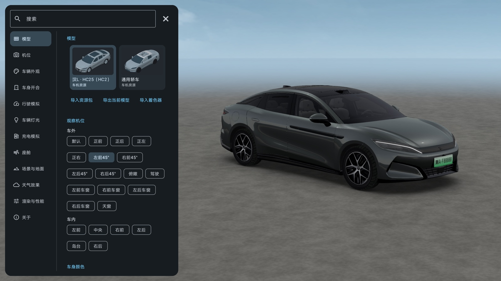

# BYD VehicleModelLab

**简体中文** | [English](README.en.md)

面向 BYD DiLink 的车辆模型解析与交互渲染项目。基于 Kotlin、OpenGL ES 3.0 和 Jetpack Compose Material 3，提供独立渲染模块、资源包管理及演示应用。



## 功能

- GPAK、GWM、GWA、材质、纹理及场景解析。
- 车身开合、灯光、配色、行驶、充电、天气与座舱气流模拟。
- 车内外机位、触摸手势、惯性运镜及渲染质量配置。
- HCVP 独立资源包导入、导出与完整性校验。

## 兼容性

| 项目 | 要求／验证范围 |
| --- | --- |
| 系统 | Android 7.0 / API 24 及以上 |
| 图形接口 | OpenGL ES 3.0 及以上 |
| 车机验证 | 2025 款汉 L DM-p，DiLink |
| 手机验证 | Redmi K30 Pro，独立资源包导入与渲染 |

未在其他 Android 车机上验证。资源格式及交互支持取决于车型和系统版本；渲染结果受 GPU、驱动及渲染器版本影响。应用不连接实车控制接口。

## 模块结构

```text
app/                    演示应用、Material 3 参数界面、调试信息
vehicle-core/           资源解析、状态类型、资源包管理、环境资源
renderer/               OpenGL 渲染、动画、手势、缩略图、公开 API
gradle/wrapper/         Gradle Wrapper
.github/workflows/      构建与测试工作流
```

依赖关系：`app → renderer → vehicle-core`。两个库模块均不依赖 Compose 或演示应用。

## 资源加载

### 识别流程

1. 读取兼容 DiLink 资源 APK 中的 GPAK 索引。
2. 校验模型声明、网格、材质及必要场景配置。
3. 按系统车型属性匹配模型；未匹配时，从有效资源中提供可选模型。
4. 解析几何、节点、动画、纹理、光照和机位配置，提交至渲染器。

识别在应用进程内完成，不依赖 ADB、root 或无线调试。系统资源不可读取时，通过 Android 文件选择器导入 `.hcvpack`，不申请全盘存储权限。

### 着色器

兼容车机可从可读取的系统资源中加载着色器。外部着色器库以 ZIP 导入，`.es` 文件位于根目录或单层 `engine/` 目录，包含 `vs_common.es`、`fs_pbr.es`、`fragmentOutput.es` 及其引用文件。自包含 HCVP v2 已携带所需依赖。

车辆模型、车机 APK、原车贴图及外部引擎着色器不随应用分发。内置环境资源采用 CC0，来源见 [环境资源声明](vehicle-core/src/main/assets/environments/NOTICE.txt)。

### HCVP 格式

新导出采用 HCVP v2，使用 ZIP 容器：

```text
manifest.json           格式版本、UTC 创建时间、文件大小、SHA-256
model.json              模型与场景依赖图
data/<SHA-256>          按内容去重的几何、纹理及展开后的着色器
```

资源引用转换为包内标识，不包含系统 APK、原始资源路径或设备标识。导入校验文件清单、大小及 SHA-256，不依赖源设备。旧格式可导入，重新导出时转换为 v2。

资源包保存资源依赖和默认渲染配置，不保存交互中的动画、天气粒子或 GPU 状态。导出保留作者、版权及许可元数据，仅移除已知的本地路径和设备标识。资源转换不改变素材许可。

## 构建

- JDK 17
- Android SDK Platform 36
- Android Build Tools 35.0.0
- Gradle 8.11.1，由 Wrapper 提供

```bash
export ANDROID_HOME=/path/to/Android/sdk
./gradlew :vehicle-core:testDebugUnitTest :renderer:testDebugUnitTest :app:testDebugUnitTest
./gradlew :app:assembleDebug
./gradlew :app:publishRelease
```

Windows 使用 `gradlew.bat`。当前 AGP 8.9.2 对 `compileSdk 36` 存在支持范围警告。

| 产物 | 路径 |
| --- | --- |
| 调试 APK | `build/app/outputs/apk/debug/app-debug.apk` |
| 发布 APK | `build/release/BYD-VehicleModelLab-v0.1.0-universal-release.apk` |
| 核心 AAR | `build/vehicle-core/outputs/aar/vehicle-core-release.aar` |
| 渲染 AAR | `build/renderer/outputs/aar/renderer-release.aar` |

AAR 构建命令：`./gradlew :vehicle-core:assembleRelease :renderer:assembleRelease`。

包名：`com.haystudio.vehiclelab`。发布签名通过环境变量配置：

| 变量 | 用途 |
| --- | --- |
| `VEHICLELAB_KEYSTORE` | 密钥库路径 |
| `VEHICLELAB_STORE_PASSWORD` | 密钥库密码 |
| `VEHICLELAB_KEY_ALIAS` | 密钥别名 |
| `VEHICLELAB_KEY_PASSWORD` | 密钥密码 |

未配置签名时生成 `-unsigned.apk`，需签名后安装。

## 模块接入

源码集成：

```kotlin
// settings.gradle.kts
include(":vehicle-core", ":renderer")
project(":vehicle-core").projectDir = file("../BYD-VehicleModelLab/vehicle-core")
project(":renderer").projectDir = file("../BYD-VehicleModelLab/renderer")

// 应用模块 build.gradle.kts
implementation(project(":renderer"))
```

仅使用资源管理时依赖 `:vehicle-core`。直接集成 AAR 时，需同时提供两个 AAR 和 Gson 2.11.0。核心 AAR 包含 HCVP 反射序列化的混淆保留规则及 `assets/licenses/` 许可文件。

### 渲染入口

```kotlin
import com.haystudio.vehiclelab.api.VehicleModelView

val view = VehicleModelView(context)
container.addView(view)
val api = view.controller
view.setFrameRateLimit(60)
```

宿主在 `onResume`、`onPause` 中分别调用 `view.resume()`、`view.pause()`。Compose 使用 `AndroidView` 承载。

控制命令在 GL 队列执行，回调在主线程交付。暂停期间提交的命令在恢复渲染后执行。资源解析与文件操作应在后台串行执行。

### 模型与资源包

```kotlin
import com.haystudio.vehiclelab.data.*

val library = VehicleResourceLibrary(context)
val selected = library.list().firstOrNull()
if (selected != null) {
    library.repository(selected.resourcePack).use { repo ->
        repo.open()
        api.load(
            repo.load(selected), repo.desktopCamera(), repo.desktopViewOptions(),
            DayPeriod.NOON, repo.loadScene(DayPeriod.NOON)
        ) { result ->
            result.onFailure { error -> showError(error.message) }
        }
    }
    library.export(selected, outputStream, workDirectory)
}
val imported = library.import(inputStream, "模型资源")
library.delete(imported)
```

`showError`、文件流和缓存目录由宿主提供。系统资源加载前调用 `ShaderSource.init(shaderDirectory)` 初始化外部着色器；自包含 HCVP v2 无需单独初始化。

`load` 回调报告 GPU 初始化结果，新加载取消尚未完成的旧加载回调。资源库不申请权限或显示文件选择器；系统资源只读，仅导入资源可删除。

### 交互 API

```kotlin
import com.haystudio.vehiclelab.api.*
import com.haystudio.vehiclelab.data.*

api.apply(VehicleInteractionPatch(
    interiorAmbientEnabled = true,
    interiorAmbientBrightness = .5f,
    vehicleSpeedKmh = 30f,
    steeringAngleDegrees = 90f
))
api.door(VehicleCorner.LEFT_FRONT, true)
api.body(VehicleBodyState(progress = mapOf("SunRoof_Clip" to .5f)))
api.camera(CameraPreset.REAR)
api.visuals(VehicleVisualState(weather = WeatherMode.SNOW))
api.charging(ChargingPort.SLOW, 7f, ChargingCommand.CONNECT)
```

| API | 职责 |
| --- | --- |
| `VehicleInteractionPatch` | 增量更新车身、灯光与行驶状态；未提供字段保持不变 |
| `VehicleBodyState` | 单门、单窗及节点行程；0 关闭、1 全开、null 清除覆盖 |
| `VehicleVisualState` | 完整画面配置；局部更新通过快照 `copy` |
| `bodyColor` / `trimColor` / `paint` | 预设颜色与分区材质 |
| `scene` / `environment` | 时段、场景与环境照明 |
| `rasterizeThumbnail` | 不依赖 Compose 的缩略图生成 |
| `diagnostics` | 按需返回调试数据，不创建界面或定时采样 |
| `edit` | 同一 GL 队列内的渲染器扩展入口 |

`vehicleSpeedKmh` 为有符号速度，单位 km/h；负值表示倒车，优先于踏板输入。`clearVehicleSpeed = true` 恢复踏板控制。节点名称由所选模型定义。普通控制回调表示命令应用完成，不代表动画结束。

## 许可证

项目源码采用 [Apache License 2.0](LICENSE)。第三方依赖及环境素材见 [NOTICE](NOTICE)。外部模型、贴图、动画和着色器遵循各自许可。

本项目为非官方学习与研究项目，与 BYD 无隶属关系。
